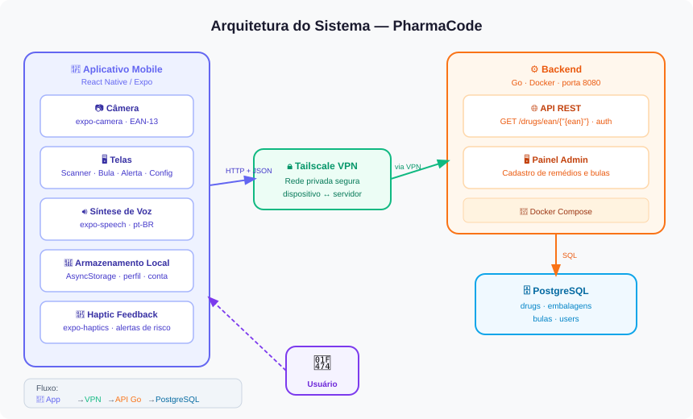
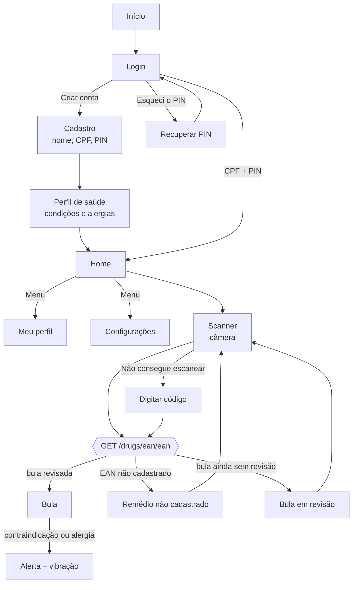
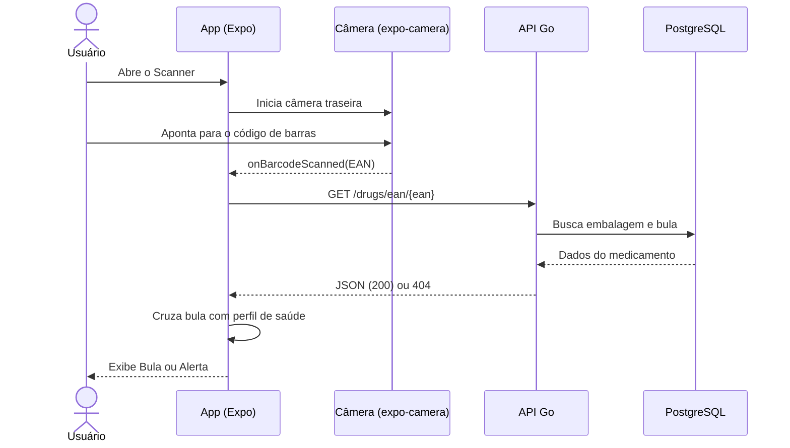
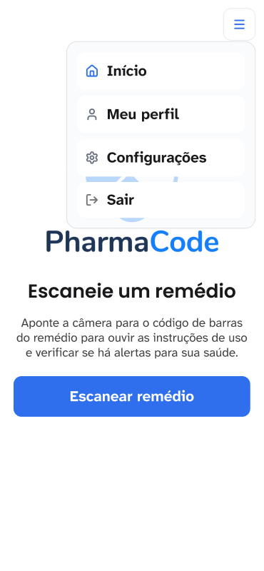
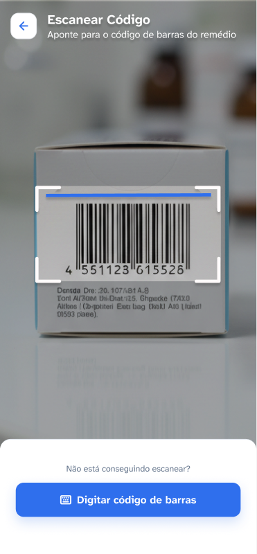
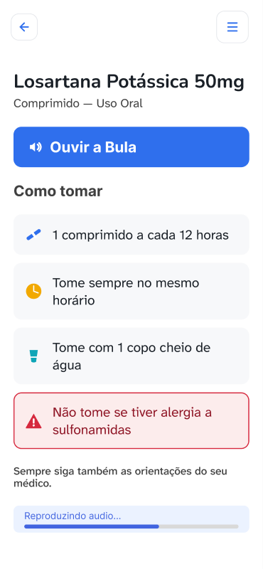
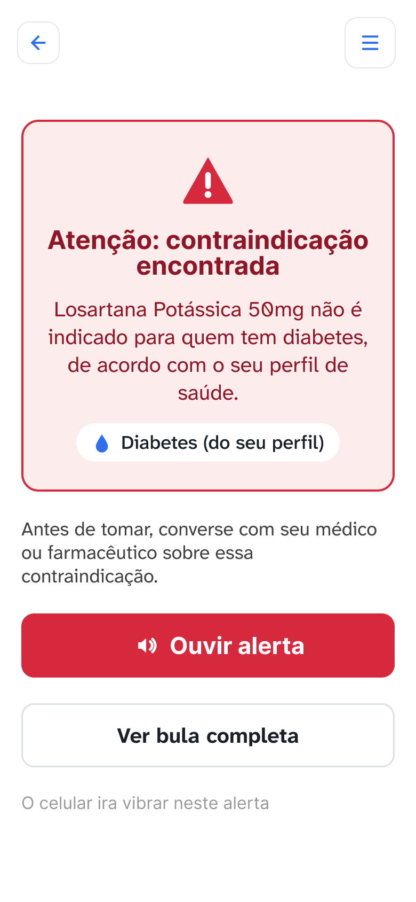
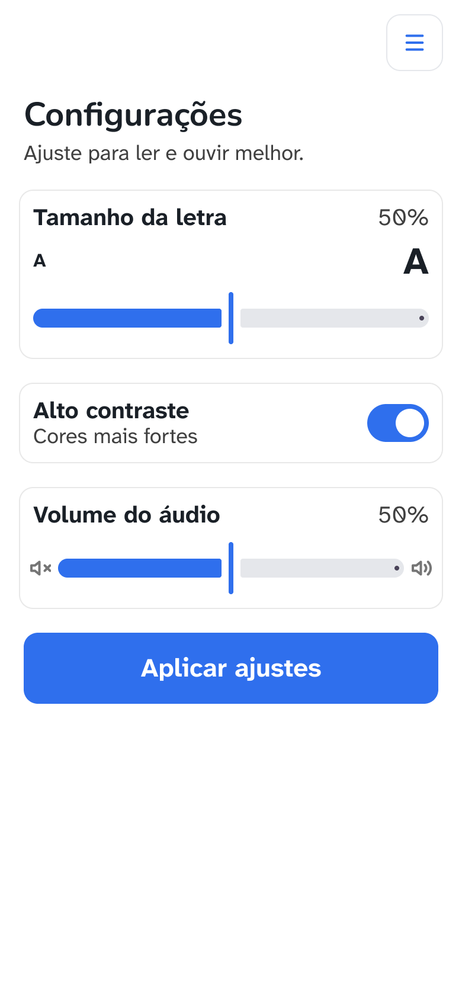

# PharmaCode

> Aplicativo mobile que simplifica bulas de medicamentos para idosos usando leitura de código de barras.

---

## Identificação do Projeto

| Campo | Informação |
|-------|-----------|
| **Projeto** | PharmaCode |
| **Equipe** | PharmaCode Team |
| **Curso** | Engenharia de Computação |
| **Disciplina** | UPX — Realidade Aumentada |
| **Professor** | Prof. Dr. Daniel Ohata |
| **Semestre** | 2026/2 |

### Integrantes

| Nome | RA | Responsabilidade |
|------|-----|-----------------|
| Amanda Silva Soares | 235276 | Frontend React Native: telas, acessibilidade, integracao com API |
| Giulia Albuquerque | 224643 | Frontend: wireframe, tela da bula, perfil de saude |
| Nathan Tanzi | 223202 | Backend: banco de dados PostgreSQL, API REST, Tailscale, painel admin |
| Marisol Marques | 222634 | Documentacao: relatorios, artigo cientifico, slides, cadastro de remedios |
| Gabriel Curto Teixeira | 235855 | Dados e testes: bulas ANVISA, EANs, QA, testes com idosos, edicao de video |

---

## Visão Geral do Projeto

O **PharmaCode** é um aplicativo móvel desenvolvido para facilitar o acesso de **idosos** às informações contidas em bulas de medicamentos. A solução utiliza a **câmera do smartphone** para escanear o código de barras (EAN-13) de uma embalagem e exibe, na tela, uma bula simplificada com linguagem acessível, ícones visuais e leitura em voz alta.

A Realidade Aumentada é aplicada por meio do **reconhecimento de código de barras em tempo real**: o usuário aponta a câmera para a embalagem, o aplicativo identifica o código EAN, consulta uma API REST e exibe as informações do medicamento diretamente na tela, como se o remédio "respondesse" ao ser apontado.

O aplicativo também verifica automaticamente se o medicamento possui **contraindicações** ou **alergias** relacionadas ao perfil de saúde do usuário, emitindo alertas com vibração.

---

## Problema

Idosos frequentemente utilizam múltiplos medicamentos, mas as bulas originais possuem texto minúsculo, linguagem técnica e informações excessivas — tornando-as praticamente inacessíveis para esse público.

**Situação atual:**
- Bulas impressas têm fonte menor que 8pt em muitos casos
- Linguagem médica é incompreensível para não profissionais
- Idosos com dificuldade visual precisam de um cuidador para interpretar o remédio
- Erros de medicação por desinformação são frequentes nessa faixa etária

**Impacto:** Risco de ingestão incorreta de medicamentos, reações alérgicas não detectadas e interações medicamentosas perigosas.

---

## Objetivos

**Objetivo Geral**

Desenvolver um aplicativo mobile que permita a idosos compreender rapidamente como tomar seus medicamentos, a partir da leitura do código de barras da embalagem.

**Objetivos Técnicos**

- Implementar leitura de código de barras EAN-13 via câmera em tempo real
- Integrar o aplicativo com API REST para consulta de bulas cadastradas
- Exibir bulas simplificadas com ícones, texto ampliado e linguagem acessível
- Implementar síntese de voz (Text-to-Speech) para leitura da bula em português
- Detectar contraindicações com base no perfil de saúde do usuário
- Emitir alertas com vibração (haptic feedback) para situações de risco
- Disponibilizar ajuste de tamanho de fonte, alto contraste e volume da voz para acessibilidade
- Executar a aplicação em dispositivo iOS e Android

---

## Público-Alvo

**Perfil principal:** Pessoas com 60 anos ou mais que utilizam medicamentos com frequência.

| Característica | Descrição |
|----------------|-----------|
| Faixa etária | 60+ anos |
| Familiaridade tecnológica | Baixa a média — usam smartphone básico |
| Contexto de uso | Em casa, no momento de tomar o remédio |
| Necessidades | Texto grande, linguagem simples, opção de áudio |
| Limitações | Dificuldade visual, baixa leitura, sem suporte técnico próximo |

**Perfil secundário:** Cuidadores e familiares que auxiliam idosos na administração de medicamentos.

---

## Funcionalidades

| ID | Funcionalidade | Descrição | Status |
|----|----------------|-----------|--------|
| RF01 | Escanear código de barras | Leitura de EAN-13 via câmera em tempo real | Implementado |
| RF02 | Digitar código manualmente | Entrada manual do código caso câmera não funcione | Implementado |
| RF03 | Exibir bula simplificada | Mostra como tomar, alertas e seções da bula | Implementado |
| RF04 | Ouvir bula em voz alta | Síntese de voz (TTS) lê toda a bula em pt-BR | Implementado |
| RF05 | Detectar contraindicações | Cruza perfil de saúde com bula e emite alerta | Implementado |
| RF06 | Detectar alergias | Verifica alergias do usuário contra componentes do remédio | Implementado |
| RF07 | Cadastro de usuário | Cria conta com nome, CPF e PIN de 4 dígitos | Implementado |
| RF08 | Perfil de saúde | Usuário informa condições de saúde e alergias | Implementado |
| RF09 | Login com PIN | Autenticação local por PIN numérico de 4 dígitos | Implementado |
| RF10 | Ajuste de acessibilidade | Configuração de tamanho da letra e volume do áudio (velocidade da voz fixa em 0.8) | Implementado |
| RF11 | Alto contraste | Modo de alto contraste nas Configurações (texto preto, cores mais escuras, bordas reforçadas) | Implementado |
| RF12 | Recuperação de senha | Redefinição de PIN via CPF | Implementado |
| RF13 | Histórico de medicamentos | Registrar os últimos remédios consultados (melhoria futura) | Planejado |
| RF14 | Autenticação via API | Login e cadastro sincronizados com o backend; hoje a conta fica salva apenas no dispositivo (melhoria futura) | Planejado |

---

## Requisitos Não Funcionais

| ID | Requisito | Descrição |
|----|-----------|-----------|
| RNF01 | Acessibilidade | Fonte mínima de 16sp; suporte ao TalkBack/VoiceOver; rótulos de acessibilidade em todos os botões |
| RNF02 | Desempenho | Leitura do código de barras em menos de 2 segundos em condições normais de iluminação |
| RNF03 | Compatibilidade | Testado em iPhone 11, iPhone 13 e Samsung Galaxy A54 via Expo Go (SDK 58) |
| RNF04 | Conectividade | Requer conexão com a VPN (Tailscale) para consultar bulas via API |
| RNF05 | Segurança | PIN de 4 dígitos armazenado localmente no dispositivo (AsyncStorage); sem senhas ou chaves no repositório |
| RNF06 | Usabilidade | Interface com botões de mínimo 44×44pt; feedback visual e tátil em ações importantes |
| RNF07 | Portabilidade | Desenvolvido com Expo Managed Workflow para facilitar build multiplataforma |

---

## Tecnologias Utilizadas

### Frontend (Aplicativo Mobile)

| Tecnologia | Versão | Utilização |
|-----------|--------|-----------|
| React Native | 0.88.1 | Framework principal do aplicativo |
| React | 19.3.0 | Biblioteca de componentes |
| Expo SDK | 58 | Toolchain e runtime mobile (Expo Managed Workflow) |
| expo-camera | 58.0.14 | Acesso à câmera e leitura de código de barras (EAN-13, EAN-8, UPC-A) |
| expo-speech | 58.0.3 | Síntese de voz (Text-to-Speech) em pt-BR |
| expo-haptics | 58.0.7 | Feedback tátil (vibração) em alertas |
| expo-updates | 58.0.19 | Recebimento de atualizações publicadas via EAS Update |
| @react-navigation/stack | 7.x | Navegação entre telas |
| @react-native-async-storage/async-storage | 2.2.0 | Armazenamento local de perfil, conta e configurações |
| react-native-svg | 15.16.0 | Ícones vetoriais (SVG) na interface |
| react-native-safe-area-context | 5.10.1 | Compatibilidade com notch e Dynamic Island |
| Atkinson Hyperlegible Next | 0.4.x (@expo-google-fonts) | Fonte de alta legibilidade para acessibilidade |

### Backend

Repositório: [Ntanzi07/PharmaCode-UPX2026](https://github.com/Ntanzi07/PharmaCode-UPX2026)

| Tecnologia | Versão | Utilização |
|-----------|--------|-----------|
| Go | 1.26 | API REST (`cmd/api`) |
| pgx | 5.11.0 | Driver PostgreSQL da API |
| PostgreSQL | 16 (imagem `postgres:16-alpine`) | Banco de dados relacional |
| golang-migrate | 4.17.1 | Aplicação automática das migrations (`db/migrations`) |
| Swagger (swaggo) | 1.16.6 | Documentação da API em `/docs` |
| React + TypeScript + Vite | 19.1 / 5.9 / 8.0 | Painel admin web |
| nginx | 1.27 (alpine) | Servidor do painel admin e proxy de `/api` para a API |
| Docker / Docker Compose | — | Execução dos serviços `db`, `migrate`, `api` e `web` |
| Tailscale | — | VPN para comunicação entre o smartphone e o servidor |

### Ferramentas

| Tecnologia | Versão | Utilização |
|-----------|--------|-----------|
| GitHub | — | Controle de versão e repositório |
| EAS CLI | 27.2.0 | Publicação do app via EAS Update (Expo Application Services) |
| Expo Go | SDK 58 | Execução do aplicativo nos smartphones de teste |
| Node.js | 20.x | Ambiente para ferramentas Expo |
| npm | 10.x | Gerenciador de pacotes |

---

## Hardware Utilizado

| Equipamento | Modelo | Sistema | Finalidade |
|-------------|--------|---------|-----------|
| MacBook Air | Apple MacBook Air M1 (2020), 8 GB RAM | macOS Tahoe 26.5.1 | Desenvolvimento do aplicativo (Expo/Metro) e publicação via EAS Update |
| iPhone 11 | Apple iPhone 11 | iOS | Testes do aplicativo (câmera, TTS, haptics) |
| iPhone 13 | Apple iPhone 13 | iOS | Testes do aplicativo (câmera, TTS, haptics) |
| Samsung Galaxy A54 | Samsung Galaxy A54 | Android | Testes de compatibilidade |
| Notebook | Notebook do Nathan | Ubuntu (Linux) | Servidor do backend (API Go + PostgreSQL via Docker) e painel admin |

---

## Arquitetura do Sistema



```
Usuário
  │
  ▼
Aplicativo PharmaCode (React Native / Expo SDK 58, executado no Expo Go)
  │
  ├── Câmera do dispositivo
  │     └── expo-camera reconhece EAN-13 / EAN-8 / UPC-A
  │
  ├── Armazenamento local (AsyncStorage)
  │     └── Conta, perfil de saúde e configurações
  │
  ├── EAS Update (servidores da Expo)
  │     └── Entrega a versão publicada do app ao Expo Go
  │
  └── API REST (rede Tailscale)
        │
        ▼
    Servidor Go — porta 8080 (GET /drugs/ean/{ean})
        │
        ▼
    PostgreSQL (Docker)
        ▲
        │
    Painel admin web (React + nginx) — porta 3000
    (cadastro de remédios, embalagens, bulas, interações e usuários)
```

**Fluxo de consulta de medicamento:**

```
1. Usuário aponta a câmera para o código de barras
2. expo-camera reconhece o código e entrega o número (EAN)
3. App faz GET /drugs/ean/{ean} para a API
4. API retorna os dados do medicamento e da bula simplificada
   (404 se o EAN não estiver cadastrado)
5. App exibe a Bula, ou as telas "Remédio não cadastrado" / "Bula em revisão"
6. Na Bula, o app cruza contraindicações e componentes com o perfil local
7. Se houver risco → vibração e tela de Alerta
```

---

## Funcionamento da Realidade Aumentada

**Tipo de abordagem:** reconhecimento de marcador — o código de barras impresso na embalagem funciona como marcador (Barcode Recognition).

**Tecnologia:** componente `CameraView` do `expo-camera` 58, que usa o leitor de códigos nativo do sistema: **Vision framework** no iOS e **ML Kit** no Android. O processamento acontece no próprio aparelho, sem serviço de visão na nuvem.

**Fluxo técnico:**

```
1. Usuário abre a tela Scanner → câmera traseira é iniciada
2. Sobre a imagem da câmera, o app desenha uma moldura de mira
   indicando onde posicionar o código
3. O leitor nativo analisa os quadros da câmera procurando
   códigos ean13, ean8 ou upc_a
4. Ao reconhecer um código, o callback onBarcodeScanned recebe
   o número (ex.: 7896094211131) e a leitura é pausada
5. Sobre a câmera aparece a camada "Buscando remédio..." enquanto
   o app chama GET /drugs/ean/{ean}
6. Com a resposta, o app abre a tela da Bula com o conteúdo
   simplificado do remédio reconhecido
7. Na Bula, o app cruza a bula com o perfil de saúde do usuário;
   se houver risco, vibra (expo-haptics) e abre a tela de Alerta
```

**Configuração da câmera** (`src/screens/ScannerScreen.js`):

```js
<CameraView
  barcodeScannerSettings={{ barcodeTypes: ['ean13', 'ean8', 'upc_a'] }}
  onBarcodeScanned={escaneado ? undefined : handleBarCodeScanned}
/>
```

- `barcodeTypes` limitado aos formatos usados em embalagens de medicamentos, para reduzir leituras falsas
- `onBarcodeScanned` é desativado após a primeira leitura, evitando várias requisições para o mesmo código

**Elementos virtuais sobrepostos à câmera:** moldura de mira (cantos destacados) e indicador de busca ("Buscando remédio...").

**Limitação:** as informações da bula não ficam ancoradas sobre a embalagem na imagem da câmera; elas são exibidas em uma tela própria após o reconhecimento.

---

## Estrutura do Projeto

```
pharmacode/
│
├── src/
│   ├── components/          # Componentes reutilizáveis
│   ├── context/             # Contextos React (cores, config, voz)
│   ├── data/                # Dados locais (medicamentos de exemplo, condições)
│   ├── screens/             # Telas do aplicativo
│   ├── services/            # Integração com API REST
│   └── utils/               # Funções auxiliares (formatação, estilos, tema)
│
├── assets/
│   ├── icons/               # Ícones SVG da interface
│   └── logo/                # Logotipo do aplicativo
│
├── docs/
│   ├── diagrams/            # Diagramas de arquitetura
│   ├── images/              # Screenshots e evidências
│   └── documents/           # Documentos complementares (relatórios, slides)
│
├── App.js                   # Ponto de entrada, configuração de navegação
├── app.json                 # Configurações do Expo
├── package.json             # Dependências do projeto
├── metro.config.js          # Configuração do Metro bundler (suporte a SVG)
└── .gitignore
```

---

## Principais Componentes

| Componente / Arquivo | Responsabilidade |
|----------------------|-----------------|
| `src/screens/InicioScreen.js` | Tela de boas-vindas com acesso a login e cadastro |
| `src/screens/ScannerScreen.js` | Tela de leitura do código de barras com câmera em tempo real |
| `src/screens/BulaScreen.js` | Exibe a bula simplificada com TTS, progresso de áudio e seções |
| `src/screens/AlertaScreen.js` | Tela de alerta para contraindicações e alergias detectadas |
| `src/screens/HomeScreen.js` | Tela inicial com botão de scan e acesso às funcionalidades |
| `src/screens/CadastroScreen.js` | Cadastro de conta (nome, CPF, PIN) — etapa 1/2 |
| `src/screens/FormCadastroScreen.js` | Cadastro de perfil de saúde (condições e alergias) — etapa 2/2 |
| `src/screens/LoginScreen.js` | Autenticação com CPF e PIN |
| `src/screens/RecuperarSenhaScreen.js` | Redefinição do PIN a partir do CPF |
| `src/screens/ConfigScreen.js` | Configurações de acessibilidade (fonte, voz, tema) |
| `src/screens/PerfilScreen.js` | Visualização e edição do perfil de saúde |
| `src/screens/DigitarCodigoScreen.js` | Entrada manual do código EAN quando câmera não funciona |
| `src/screens/NaoEncontradoScreen.js` | Tela exibida quando medicamento não está cadastrado |
| `src/components/PinInput.js` | Campo de PIN numérico de 4 dígitos com foco automático |
| `src/components/AlergiasEditor.js` | Editor de lista de alergias do usuário |
| `src/components/MenuBotao.js` | Botão de menu hambúrguer presente nas telas internas |
| `src/components/IconeCondicao.js` | Ícone correspondente a cada condição de saúde do perfil |
| `src/context/ConfigContext.js` | Contexto global de cores, estilos e opções de voz |
| `src/services/medicamentos.js` | Consulta `GET /drugs/ean/{ean}`, trata erros de conexão e converte a resposta da API para o formato das telas |
| `src/utils/alergias.js` | Detecção de alergias entre perfil do usuário e medicamento |
| `src/utils/contraindicacoes.js` | Busca de contraindicações no texto da bula |
| `src/utils/formatar.js` | Formatação de CPF e outros campos |
| `src/utils/theme.js` | Constantes de design (fontes, espaçamentos, raios) |
| `src/data/condicoes.js` | Lista de condições de saúde suportadas |
| `src/data/medicamentos.js` | Medicamentos de exemplo, usados quando `EXPO_PUBLIC_API_URL` não está configurada |

---

## Dependências

As dependências estão listadas no arquivo `package.json`. As principais são:

```
expo ^58.0.0
react 19.3.0
react-native 0.88.1
expo-camera ~58.0.14
expo-speech ~58.0.3
expo-haptics ~58.0.7
expo-updates ~58.0.19
@react-navigation/native ^7.0.0
@react-navigation/stack ^7.0.0
@react-native-async-storage/async-storage 2.2.0
react-native-svg 15.16.0
react-native-safe-area-context ~5.10.1
react-native-screens ~4.30.0
react-native-gesture-handler ~3.3.0
@expo-google-fonts/atkinson-hyperlegible-next ^0.4.1
@react-native-community/slider 5.2.1
lucide-react-native ^1.47.0
```

Dependências de desenvolvimento: `react-native-svg-transformer` ^1.5.3 (importar arquivos `.svg` como componentes).

Todas são obtidas pelo registro público do npm ([npmjs.com](https://www.npmjs.com)).

Para instalar todas as dependências: `npm install`

---

## Configuração do Ambiente

### Pré-requisitos

- **Node.js** 20 ou superior ([nodejs.org](https://nodejs.org)) — já inclui o npm
- **Git** ([git-scm.com](https://git-scm.com))
- **Expo Go** no smartphone ([App Store](https://apps.apple.com/app/expo-go/id982107779) / [Play Store](https://play.google.com/store/apps/details?id=host.exp.exponent)), compatível com o SDK 58
- **Tailscale** no smartphone, conectado à mesma rede do servidor do backend ([tailscale.com](https://tailscale.com/download))
- Conta Expo (gratuita) membro da organização `upxs-team`, para abrir a versão publicada

Não é necessário instalar o Expo CLI globalmente: os comandos são executados com `npx`.

### 1. Clonar o repositório

```bash
git clone https://github.com/MandaSoares/pharmacode.git
cd pharmacode
```

### 2. Instalar dependências

```bash
npm install
```

### 3. Configurar a URL da API

Crie um arquivo `.env` na raiz do projeto (mesma pasta do `App.js`). Ele não é versionado (veja `.gitignore`):

```env
EXPO_PUBLIC_API_URL=http://<IP-do-servidor-no-Tailscale>:8080
```

O IP é o endereço da máquina do backend na rede Tailscale (exibido no aplicativo Tailscale). Sem esse arquivo, o app usa os remédios de exemplo de `src/data/medicamentos.js`.

### 4. Backend

A API Go, o banco PostgreSQL e o painel admin ficam no repositório [Ntanzi07/PharmaCode-UPX2026](https://github.com/Ntanzi07/PharmaCode-UPX2026) e são executados com Docker Compose (requisito: Docker com Compose).

```bash
git clone https://github.com/Ntanzi07/PharmaCode-UPX2026.git
cd PharmaCode-UPX2026
cp .env.example .env        # definir ADMIN_NAME, ADMIN_EMAIL e ADMIN_PASSWORD
docker compose up --build -d
```

O container `migrate` aplica as migrations automaticamente. Serviços disponíveis:

| Serviço | Endereço |
|---------|----------|
| Painel admin | `http://localhost:3000` |
| API | `http://localhost:8080` |
| Swagger | `http://localhost:8080/docs` |
| PostgreSQL | `localhost:5433` |

O app consome apenas `GET /drugs/ean/{ean}`, que não exige login e só retorna bulas **revisadas** por um farmacêutico (perfil `reviewer`) no painel. Para o celular acessar a API, o computador do backend e o smartphone devem estar na mesma rede Tailscale.

Para conferir o acesso, abra no navegador do smartphone (com o Tailscale ligado) `http://<IP-Tailscale>:8080/drugs/ean/7896094211131`; deve aparecer o JSON do medicamento.

---

## Como Executar

### Opção 1 — Versão publicada (sem computador)

1. Abra o **Expo Go** e entre com uma conta Expo membro da organização `upxs-team`
2. Ligue o **Tailscale** no smartphone
3. Escaneie o QR Code da versão publicada, disponível em [expo.dev → upxs-team/pharmacode → Updates](https://expo.dev/accounts/upxs-team/projects/pharmacode/updates) (botão **Preview**)
4. O app abre no Expo Go e fica salvo na lista de projetos recentes

### Opção 2 — Modo de desenvolvimento

```bash
npx expo start -c
```

Escaneie o QR Code exibido no terminal com o Expo Go (iPhone: câmera; Android: botão *Scan QR code* do Expo Go). O terminal mostra os logs de cada consulta (`[API] GET ...` e `[API] resposta 200`).

### Publicar uma nova versão (EAS Update)

Após alterar o código, publique para que todos recebam a atualização no Expo Go:

```bash
npx eas-cli@latest update --branch preview --message "descrição da mudança"
```

Selecione o ambiente `preview`. O comando lê o `.env` local, então a URL da API é incluída na versão publicada. Cada publicação gera um novo QR Code em **Updates**.

---

## Como Usar

1. **Primeiro acesso:** toque em "Criar conta", informe nome, CPF e crie um PIN de 4 dígitos
2. **Perfil de saúde:** na segunda etapa do cadastro, selecione suas condições de saúde e alergias
3. **Escanear remédio:** na tela inicial, toque no botão de câmera e aponte para o código de barras da embalagem
4. **Ver a bula:** o aplicativo exibe automaticamente como tomar o medicamento, os alertas e as seções da bula
5. **Ouvir a bula:** toque em "Ouvir a Bula" para ter o conteúdo lido em voz alta
6. **Alerta de risco:** se o remédio for contraindicado para você, uma tela de alerta aparece com vibração
7. **Digitar código:** se a câmera não reconhecer o código, toque em "Digitar código" para inserir manualmente
8. **Configurações:** pelo menu, ajuste o tamanho da letra, o alto contraste e o volume do áudio, e toque em "Aplicar ajustes"

---

## Diagramas

### Fluxo de Navegação

Diagrama gerado a partir das rotas reais do aplicativo (`App.js` e chamadas `navigation.navigate` nas telas):



### Fluxo de consulta de medicamento



---

## Interface do Aplicativo

Capturas do aplicativo em execução (pasta [`docs/images/`](docs/images/)). A imagem do Scanner é do protótipo no Figma, porque a tela usa a câmera ao vivo.

| Tela | Descrição |
|------|-----------|
|  | **Home (com menu aberto)**<br/>**Finalidade:** ponto de partida para escanear um remédio.<br/>**Elementos:** logotipo, instrução curta, botão "Escanear remédio" e menu com Início, Meu perfil, Configurações e Sair.<br/>**Ação do usuário:** tocar em "Escanear remédio" ou abrir o menu. |
|  | **Scanner** (protótipo Figma)<br/>**Finalidade:** ler o código de barras da embalagem pela câmera.<br/>**Elementos:** imagem da câmera em tempo real, moldura de mira sobreposta e botão "Digitar código de barras".<br/>**Ação do usuário:** apontar a câmera para o código ou digitar o número manualmente. |
|  | **Bula simplificada**<br/>**Finalidade:** mostrar como tomar o remédio em linguagem simples.<br/>**Elementos:** nome e forma do remédio, botão "Ouvir a Bula", cards "Como tomar" com ícones, aviso de alergia em vermelho e indicador de reprodução do áudio.<br/>**Ação do usuário:** ler os cards ou tocar em "Ouvir a Bula". |
|  | **Alerta de contraindicação**<br/>**Finalidade:** avisar que o remédio conflita com o perfil de saúde.<br/>**Elementos:** caixa vermelha com o motivo, condição do perfil (ex.: Diabetes), orientação para falar com médico ou farmacêutico, botões "Ouvir alerta" e "Ver bula completa"; o celular vibra ao abrir.<br/>**Ação do usuário:** ouvir o alerta ou abrir a bula completa. |
|  | **Configurações**<br/>**Finalidade:** adaptar o app à visão e audição do usuário.<br/>**Elementos:** controle de tamanho da letra, chave de alto contraste, controle de volume do áudio e botão "Aplicar ajustes".<br/>**Ação do usuário:** ajustar os controles e tocar em "Aplicar ajustes". |

---

## Testes Técnicos

| Teste | Procedimento | Resultado esperado | Resultado obtido | Status |
|-------|--------------|--------------------|------------------|--------|
| Leitura de EAN-13 (Ansitec 500 mg) | Abrir o Scanner e apontar para o código `7896094209633` | Código reconhecido e remédio exibido | Reconhecido em menos de 1 s | Aprovado |
| Leitura de EAN-13 (Advil 12h) | Abrir o Scanner e apontar para o código da embalagem com iluminação normal | Código reconhecido | Reconhecido corretamente | Aprovado |
| Consulta à API real (Reconter 15 mg) | Escanear `7896094211131` com o backend ativo | `GET /drugs/ean/{ean}` retorna 200 e a bula é exibida | Resposta 200 registrada no Metro; bula exibida | Aprovado |
| App publicado via EAS Update | Abrir o app pelo QR Code do EAS Update no Expo Go, com o computador de desenvolvimento desligado | App abre e consulta a API normalmente | App abriu e exibiu a bula do Reconter | Aprovado |
| Leitura da bula em voz alta (TTS) | Na Bula, tocar em "Ouvir a Bula" | Bula lida em português | Lida corretamente na velocidade 0.8 | Aprovado |
| Parar áudio ao sair da tela | Iniciar o áudio e voltar para a tela anterior | Áudio para ao sair | `useFocusEffect` interrompe a fala | Aprovado |
| Detecção de contraindicação | Cadastrar uma condição no perfil e escanear um remédio contraindicado | Tela de Alerta com vibração | Alerta exibido com vibração | Aprovado |
| Detecção de alergia | Cadastrar uma alergia e escanear um remédio com esse componente | Alergia identificada no Alerta | Alergia cruzada corretamente com os componentes | Aprovado |
| Cadastro de conta | Criar conta com nome, CPF e PIN | Conta salva e acesso liberado | CPF formatado e PIN salvo localmente | Aprovado |
| Digitar código manualmente | Na tela Digitar código, informar um EAN cadastrado | Abrir a bula do remédio | Navegou para a bula corretamente | Aprovado |
| Ajuste de fonte grande | Em Configurações, aumentar o tamanho da letra e aplicar | Interface aumenta sem quebrar o layout | Layout adaptado sem quebras | Aprovado |
| Código não cadastrado | Digitar um EAN que não existe na base | Tela "Remédio não cadastrado" | Tela exibida corretamente | Aprovado |

---

## Dispositivos Testados

| Dispositivo | Sistema | Versão | Resultado |
|-------------|---------|--------|-----------|
| iPhone 11 | iOS | Não registrada | Compatível (Expo Go, SDK 58) |
| iPhone 13 | iOS | Não registrada | Compatível (Expo Go, SDK 58) |
| Samsung Galaxy A54 | Android | Não registrada | Compatível (Expo Go, SDK 58) |

---

## Limitações Conhecidas

| Limitação | Descrição |
|-----------|-----------|
| Depende do servidor e da VPN | A consulta de bulas exige conexão com a API, acessada pela rede Tailscale. O servidor roda no notebook de um integrante, que precisa ficar ligado e conectado |
| Informação não sobreposta à embalagem | Após o reconhecimento do código, a bula é exibida em uma tela própria; o conteúdo não fica ancorado sobre a embalagem na imagem da câmera |
| Câmera em condições ruins | A leitura do código de barras pode falhar com pouca iluminação ou embalagem amassada |
| Bulas simplificadas revisadas manualmente | A base possui cerca de 29 mil medicamentos cadastrados, mas poucos têm bula simplificada revisada; os demais exibem a tela "Bula em revisão" |
| Base de embalagens limitada | Apenas embalagens (EAN) cadastradas no painel admin são reconhecidas |
| Autenticação local | Login e cadastro ficam salvos apenas no dispositivo; sincronização com o backend é uma melhoria futura |
| PIN sem criptografia | O PIN de 4 dígitos é armazenado em texto puro no AsyncStorage do dispositivo |
| Sem histórico de consultas | O aplicativo não salva o histórico de medicamentos consultados (melhoria futura) |

---

## Evidências de Funcionamento

- **Vídeo de demonstração:** gravado durante o teste com idosos; o link será adicionado nesta seção após a publicação
- **Screenshots das telas:** [`docs/images/`](docs/images/)
- **Leitura real com API:** EAN `7896094211131` (Reconter 15 mg) e `7896658002076` (Levoid 38 mcg) escaneados no iPhone; o terminal do Metro registrou `GET /drugs/ean/{ean}` com `resposta 200` e a bula foi exibida
- **Publicação via EAS Update:** versão publicada em 30/10/2026 (branch `preview`, runtime `exposdk:58.0.0`) e aberta no Expo Go sem o computador de desenvolvimento

---

## Problemas e Soluções

| Problema | Causa | Solução |
|----------|-------|---------|
| Áudio continuava tocando ao navegar para outra tela | O React Navigation não desmonta a tela ao navegar | `useFocusEffect` com `Speech.stop()` no cleanup, parando a fala quando a tela perde o foco |
| Remédio não encontrado após cadastro no painel | Embalagem cadastrada sem o EAN correto | Conferir o campo EAN da embalagem no painel admin |
| Ícones SVG não renderizavam | O Metro bundler não importa `.svg` por padrão | Configurar `metro.config.js` com `react-native-svg-transformer` |
| Câmera não abria no iOS Simulator | O simulador não possui câmera real | Testar as funções de câmera sempre em dispositivo físico |
| API inacessível no dispositivo físico | A rede local bloqueava a porta do servidor | Usar a VPN Tailscale para comunicação entre celular e servidor |
| App mostrava "Remédio não cadastrado" para EAN existente | Ao baixar o projeto do GitHub, o arquivo `.env` (ignorado pelo `.gitignore`) não veio junto; sem `EXPO_PUBLIC_API_URL`, o app usava os remédios de exemplo | Criar o `.env` na raiz com `EXPO_PUBLIC_API_URL` e reiniciar com `npx expo start -c` |
| Alerta "Sem conexão com o servidor" mesmo com a API respondendo | A API passou a enviar `active_ingredients` como lista, mas o app lia `active_ingredient` como texto, gerando um erro tratado como falha de conexão | Função `principiosAtivos()` aceita os dois formatos; erros de leitura passaram a ter mensagem própria, separada do erro de conexão |
| Projeto não abria no Expo Go atualizado | O Expo Go só executa a versão mais recente do SDK, e o projeto estava no SDK 57 | Atualizar o projeto para o Expo SDK 58 e bibliotecas compatíveis |
| App dependia do computador com `npx expo start` para abrir | No modo de desenvolvimento, o código é servido pelo Metro do computador | Publicar o app com EAS Update (`runtimeVersion` com `policy: sdkVersion`) e abrir pelo QR Code no Expo Go |

---

## Cronograma Técnico

| Semana | Atividade | Responsável | Status |
|--------|-----------|-------------|--------|
| 1–2 | Definição do problema, pesquisa com público-alvo, wireframes | Giulia, Gabriel | Concluído |
| 3–4 | Configuração do ambiente, estrutura base do React Native | Amanda | Concluído |
| 5–6 | Câmera e leitura de código de barras | Amanda | Concluído |
| 7–8 | Telas (Home, Scanner, Bula) | Amanda, Giulia | Concluído |
| 9–10 | API REST, banco de dados e painel admin | Nathan | Concluído |
| 9–10 | Cadastro de remédios e bulas (ANVISA, EANs) | Gabriel, Marisol | Concluído |
| 11–12 | Alertas, contraindicações e alergias | Amanda, Giulia | Concluído |
| 13–14 | Acessibilidade (voz, tamanho da letra, alto contraste) | Amanda | Concluído |
| 15 | Testes com idosos e em dispositivos reais | Equipe | Concluído |
| 15 | Documentação (README, relatório, artigo, slides) | Marisol, Amanda | Concluído |
| 16 | Entrega final e apresentação | Equipe | Concluído |

---

## Controle de Versão

O projeto utiliza **Git** com repositório no **GitHub**.

**Práticas adotadas:**
- Commits com mensagens descritivas em português, no padrão Conventional Commits (`feat`, `fix`, `docs`, `chore`)
- Branch `main` como versão estável do projeto
- Versão entregue marcada com a tag `v1.0.0` em [Releases](https://github.com/MandaSoares/pharmacode/releases)
- Arquivo `.gitignore` configurado para ignorar `node_modules/`, `.expo/`, `dist/`, `.env`, `.DS_Store` e chaves de assinatura (`*.jks`, `*.p8`, `*.p12`, `*.key`)

**Exemplos de commits do histórico:**
```
fix: ler active_ingredients como array e separar erro de conexão
chore: atualizar Expo para SDK 58 e ignorar .DS_Store
chore: configurar EAS Update e remover permissões duplicadas
docs: README completo e diagrama de arquitetura
docs: adicionar screenshots de alerta e configuracoes
```

---

## Repositórios e Recursos

| Recurso | Link |
|---------|------|
| Código-fonte do aplicativo | [github.com/MandaSoares/pharmacode](https://github.com/MandaSoares/pharmacode) |
| Projeto Expo (EAS Update) | [expo.dev/accounts/upxs-team/projects/pharmacode](https://expo.dev/accounts/upxs-team/projects/pharmacode) |
| Backend (API Go, PostgreSQL e painel admin) | [github.com/Ntanzi07/PharmaCode-UPX2026](https://github.com/Ntanzi07/PharmaCode-UPX2026) |

---

## Melhorias Futuras

- Histórico dos remédios consultados (RF13)
- Login e cadastro sincronizados com o backend (RF14)
- Criptografia do PIN armazenado no dispositivo
- Exibir as informações principais sobrepostas à embalagem na imagem da câmera
- Publicar a API com HTTPS público, eliminando a necessidade do Tailscale no celular
- Ampliar o número de bulas simplificadas revisadas

---

## Checklist de Entrega

- [x] Código-fonte atualizado no repositório
- [x] `.gitignore` configurado (`node_modules`, `.expo`, `dist`, `.env`, `.DS_Store`)
- [x] Sem senhas ou tokens no repositório
- [x] `README.md` preenchido com informações reais do projeto
- [x] Pasta `docs/` com `diagrams/`, `images/` e `documents/`
- [x] Tecnologias documentadas com versões
- [x] Funcionalidades documentadas com status real
- [x] Arquitetura do sistema apresentada
- [x] Funcionamento da RA explicado tecnicamente
- [x] Principais componentes documentados
- [x] Procedimentos de instalação, execução e utilização
- [x] Screenshots das telas em `docs/images/`
- [x] Diagramas de arquitetura, navegação e sequência
- [x] Testes documentados
- [x] Dispositivos testados identificados
- [x] Limitações conhecidas documentadas
- [x] Evidências de funcionamento
- [x] Histórico de commits representando a evolução do projeto

---

*PharmaCode — tornando medicamentos acessíveis para quem mais precisa*
